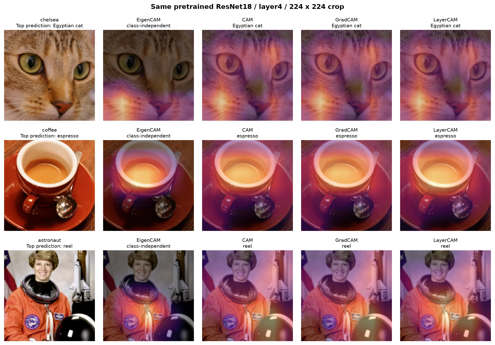
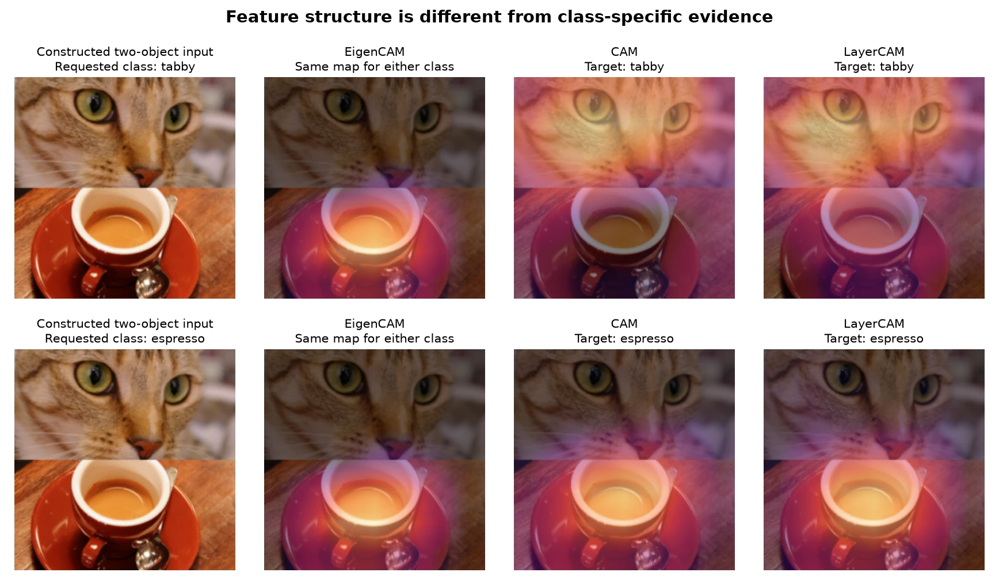
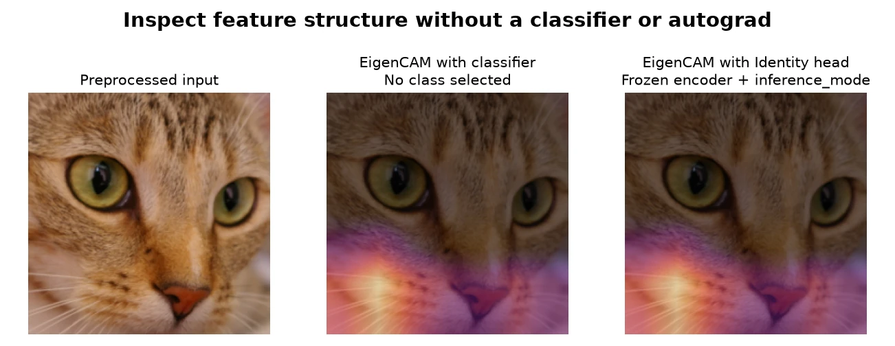

# EigenCAM: feature inspection without a classifier

`EigenCAM` adds a class-independent view of spatial features. Its specific use case is inspecting a frozen
feature encoder during inference, before choosing or attaching a downstream classifier. For example, an
image-retrieval encoder returns an embedding rather than class logits; its features can still be visualized
without enabling autograd or inventing a scalar output target.

This is a feature-structure visualization, not an explanation of why a model predicted a particular class.
For that question, use a class-specific method such as `LayerCAM`. EigenCAM's value here is availability in
the headless, inference-only workflow, rather than better localization or lower runtime.

## Reproduce the comparison

From the repository root, install the existing script dependencies and run:

```bash
uv pip install -e '.[scripts]'
python scripts/eigencam_comparison.py --device cpu \
  --inputs downloads/eigencam-inputs --output downloads/eigencam-cpu
# Optional on an Apple Silicon machine:
python scripts/eigencam_comparison.py --device mps \
  --inputs downloads/eigencam-inputs --output downloads/eigencam-mps
```

The script downloads the three source photos from a pinned scikit-image revision and verifies their SHA256
checksums. It also downloads torchvision's `ResNet18_Weights.IMAGENET1K_V1` checkpoint on first use. It saves
three figures (PNG originals and compact WebP copies) and a JSON report with per-image scores, every measured
latency sample, environment and source hashes. A separate CUDA timing matrix is reported below.

All methods use the same pretrained ResNet18 in evaluation mode, frozen parameters, float32 inputs,
batch size one, the weights' resize/center-crop/normalization transform, and `layer4` features of shape
`(1, 512, 7, 7)`. Class-specific methods target the same original top prediction for each photo. Figures
show the actual 224 × 224 model crop, with the same bilinear interpolation, linear magma color scale and
50% overlay blend for every method. Each map is independently normalized to [0, 1].

## What the maps show



EigenCAM emphasizes the cat's lower face, the coffee surface and parts of the astronaut's suit. These are
regions of variation in the selected features; they need not be the evidence for a selected prediction.
The other methods show evidence for the displayed class. The astronaut photo's top prediction is `reel`,
which is not a ground-truth label for the person: the figure retains this model error rather than treating
the image name as an ImageNet class.

As an additional diagnostic, the existing `ClassificationMetric` evaluates the top-class softmax confidence
after multiplying the **normalized model input** by the bilinearly resized map. Zero in this input space
corresponds to the normalization mean, not a black pixel. The original class stays fixed during scoring.
On these three photos, the CPU results are:

| Method | Average Drop ↓ | Confidence increases |
| --- | ---: | ---: |
| EigenCAM | 40.70% | 1 / 3 |
| CAM | 30.28% | 2 / 3 |
| GradCAM | 30.46% | 2 / 3 |
| LayerCAM | 33.82% | 1 / 3 |

EigenCAM does **not** improve this class-confidence diagnostic. Three illustrative photos are not a dataset
benchmark, and this mask-based score does not measure localization accuracy or feature-encoder utility.
No bounding boxes or segmentation annotations are used. Per-image results and unrounded values are in the
[CPU JSON report](../img/eigencam/results-cpu.json).

## Why class independence also limits the method



This controlled input stacks center-fitted crops of the cat and coffee photos; it is a constructed illustration,
not a natural multi-object scene or an extra metric sample. Requesting `tabby` versus `espresso` produces exactly
the same EigenCAM map (maximum absolute difference: **0**), while CAM and LayerCAM respond to the selected class.
EigenCAM mainly emphasizes the coffee in this example; class independence does not guarantee that every object
will be highlighted. It cannot separate class-specific evidence in a multi-object input.

## A workflow that needs no class scores or gradients

The following example uses the downloaded photo and removes the pretrained classifier. All model parameters
are frozen, the input requires no gradients, and the entire forward and extraction run under inference mode:

```python
import torch
from PIL import Image
from torchvision.models import ResNet18_Weights, resnet18
from torchcam.methods import EigenCAM

weights = ResNet18_Weights.IMAGENET1K_V1
encoder = resnet18(weights=weights).eval().requires_grad_(False)
encoder.fc = torch.nn.Identity()
image = Image.open("downloads/eigencam-inputs/chelsea.png").convert("RGB")
input_tensor = weights.transforms()(image).unsqueeze(0)

with EigenCAM(encoder, target_layer="layer4") as extractor:
    with torch.inference_mode():
        embedding = encoder(input_tensor)  # (1, 512), not class logits
        feature_map = extractor()[0]      # (1, 7, 7), no class or score needed
```



The reproduction script checks that replacing `fc` with `Identity` leaves the EigenCAM map unchanged
(maximum absolute difference: **0** on both tested devices). It also checks the relevant constraints of the
alternatives: plain CAM cannot resolve a linear classification head, and LayerCAM cannot differentiate an
output produced under `torch.inference_mode()`. A frozen model alone does **not** prevent LayerCAM from working:
with autograd enabled and a suitable differentiable scalar target, it remains an option, including for embeddings.
ScoreCAM can avoid gradients but still needs model output scores for masked-input evaluations.

## Runtime under the same conditions

Recorded on an Apple M5 with 24 GiB unified memory, macOS 27.0, Python 3.11.15, torch 2.14.1 and torchvision 0.29.1.
Each device uses three fresh worker processes, with rotating method order, one CPU thread and one inter-op thread.
For each method and timing scope, the first call and ten subsequent warmups are excluded, then 50 calls are measured
per process on the same cat input. Device work is synchronized immediately before and after the timed region.
The table reports the median of the three process medians, in milliseconds:

| Method | CPU extraction | CPU forward + extraction | MPS extraction | MPS forward + extraction |
| --- | ---: | ---: | ---: | ---: |
| EigenCAM | 2.347 | 12.093 | 3.796 | 7.746 |
| CAM | 0.034 | 9.703 | 0.223 | 3.898 |
| GradCAM | 0.101 | 9.931 | 0.298 | 4.236 |
| LayerCAM | 0.094 | 9.942 | 0.287 | 4.172 |

The extraction scope excludes the preceding model forward; it includes differentiation for GradCAM and LayerCAM.
For these frozen models, the input requires gradients only for those two methods. The other two methods use
inference mode. Setup, image loading, preprocessing, rendering, validation and CPU transfer of display maps
are excluded from both timing scopes. This compares each method's supported execution path without forcing
EigenCAM to build an unnecessary autograd graph.

EigenCAM is slower than the three alternatives in this setting. The gradient cost at the final ResNet layer is
small; computing an SVD does not automatically save time. PyTorch also emits a warning that this `(49, 512)`
matrix is too large for its MPS threadgroup memory and internally falls back to CPU SVD. The MPS measurements
therefore include that backend fallback and must not be presented as native MPS SVD performance. This is
distinct from TorchCAM's explicit fallback for MPS versions that raise `NotImplementedError`.

Process-median ranges, p95 values, raw samples and captured worker warnings are in the
[CPU report](../img/eigencam/results-cpu.json) and [MPS report](../img/eigencam/results-mps.json).
These are one-model, one-layer, batch-one measurements on one machine, not a general runtime ranking.
Earlier/higher-resolution target layers and larger channel counts can make SVD substantially more expensive.

## Additional NVIDIA CUDA measurements

The submitted EigenCAM implementation was also checked on an NVIDIA A40 (driver 550.54.14),
Python 3.11.5, the minimum-supported torch 2.4.1+cu121, torchvision 0.19.1+cu121 and cuDNN 9.1.0.
The EigenCAM and comparison-script tests passed (48 passed, two MPS tests skipped), followed by a 12-configuration
smoke check and three fresh processes each covering a 24-configuration timing matrix.
The pretrained weights loaded strictly with no missing or unexpected keys.

The matrix covers ResNet18 (`layer3`/`layer4`), ResNet50 (`layer3`/`layer4`) and MobileNetV3 Large
(`features.12`/`features.16`), input crops of 224 or 384 pixels, and batches of one or eight.
The three pinned photos above are cycled across each batch. We use float32, disable matmul and
cuDNN TF32 and cuDNN benchmarking, and set CPU/inter-op threads to one. Every method and timing
scope excludes its first call and five warmups, then records 20 synchronized calls per process;
method order rotates between processes. The timing helper and execution paths are the same as above.
GPU process occupancy is checked before and after each configuration; the accepted run had no
competing process on the selected GPU. GPU clocks are not locked.

For ResNet18 / `layer4` / 224 pixels / batch one, medians of process medians are:

| Method | CUDA extraction (ms) | CUDA forward + extraction (ms) | Process-median range for forward + extraction (ms) |
| --- | ---: | ---: | ---: |
| EigenCAM | 2.782 | 6.973 | 6.944–6.989 |
| CAM | 0.383 | 4.545 | 4.544–4.551 |
| GradCAM | 0.892 | 5.842 | 5.805–5.855 |
| LayerCAM | 0.860 | 5.828 | 5.802–5.832 |

EigenCAM takes about 20% longer than LayerCAM in this configuration. Across the 24 configurations,
EigenCAM's forward-plus-extraction time is higher in 20 and lower in four; its ratio to LayerCAM
ranges from 0.916 to 10.732. The four lower-latency configurations are batch-one ResNet50 `layer4`
at 224 pixels and MobileNetV3 `features.12` at both input sizes and `features.16` at 224 pixels.
These modest advantages do not establish a general speed benefit. Earlier layers and larger batches
can substantially increase the SVD cost: ResNet50 `layer3` / 384 pixels / batch eight takes
310.995 ms for EigenCAM versus 28.979 ms for LayerCAM.

The [complete CUDA report](../img/eigencam/results-cuda.json) contains the 24 configurations,
all raw samples and process ranges, memory measurements, weight/source hashes, environment,
GPU snapshots, and the standalone harness source. Plain CAM is included only for ResNet `layer4`:
intermediate channels and MobileNetV3's multi-FC head do not satisfy its feature/head contract.
This CUDA run checks numerical validity and class independence; it adds no dataset-level quality
metric. The CUDA and Mac reports use different torch versions, so their absolute times must not
be interpreted as an isolated comparison of hardware speed.

## Other limitations and numerical conventions

- The largest feature variance can come from background, texture or nuisance variation; it is not a guarantee
  of semantic relevance, causal faithfulness, foreground coverage or segmentation quality.
- Features are centered per channel. The first principal component's sign is oriented so its largest-magnitude
  channel loading is positive, then the projection is passed through ReLU. This selects one side of the
  component; centering, sign and clipping conventions can produce different maps from other implementations.
- Repeated largest singular values make the principal direction non-unique. Very close singular values can
  also make the map sensitive to perturbations or numerical/backend differences.
- Constant features yield a zero map. Half and bfloat16 features are promoted to float32, while float64 is
  preserved. Maps remain on the activation device, even when SVD falls back to CPU.
- Callable output targets are unsupported. Accepting a class index is API compatibility only; it does not
  turn EigenCAM into a class-discriminative method.
- The example verifies behavior and exposes tradeoffs. It does not establish retrieval gains, localization
  superiority or robustness, and does not establish a runtime ranking beyond the tested hardware, models and configurations.

## Image attribution

The source revision is [scikit-image v0.25.2](https://github.com/scikit-image/scikit-image/tree/e8a42ba85aaf5fd9322ef9ca51bc21063b22fcae/skimage/data).
Its [data documentation](https://scikit-image.org/docs/0.25.x/api/skimage.data.html) identifies Chelsea as CC0
by Stefan van der Walt, coffee as CC0 by Rachel Michetti (courtesy of Pikolo Espresso Bar), and the Eileen Collins
astronaut photo as a NASA image in the public domain. The comparison crops and overlays are derived from those
photos. The cat-and-coffee input is a composition of the first two. No scikit-image runtime dependency is added.
